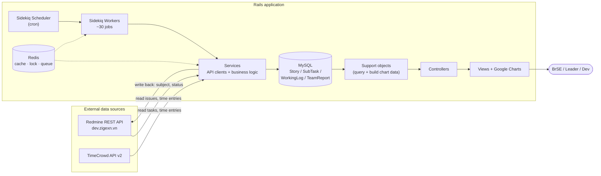
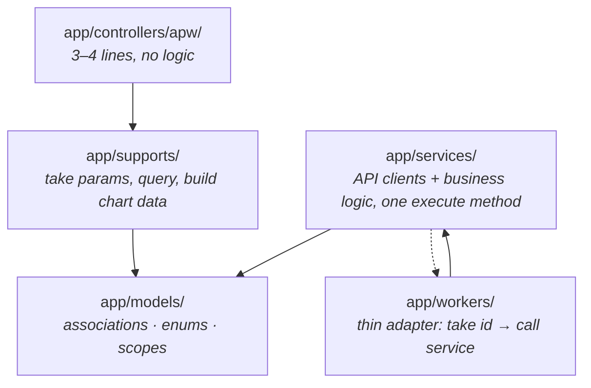
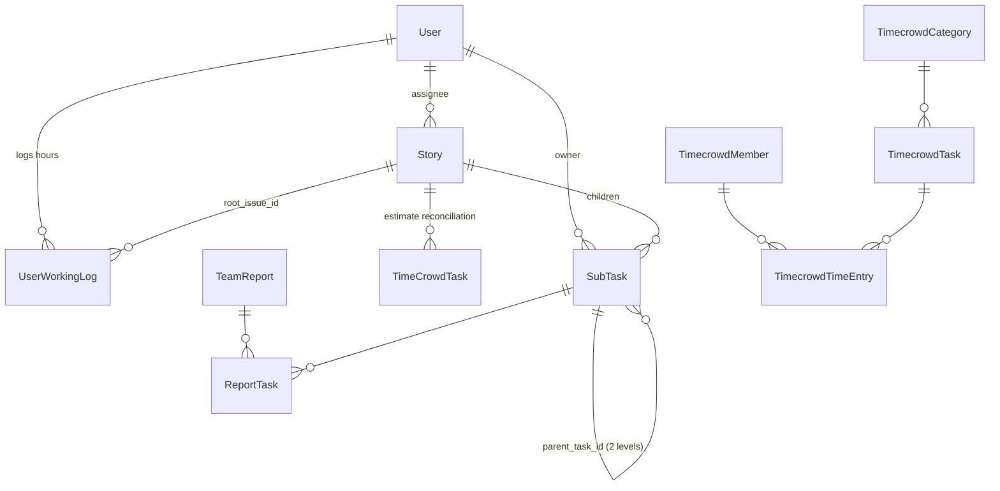
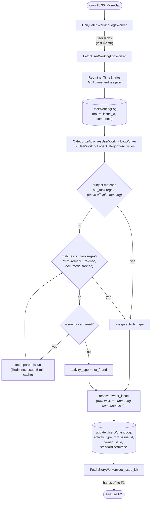
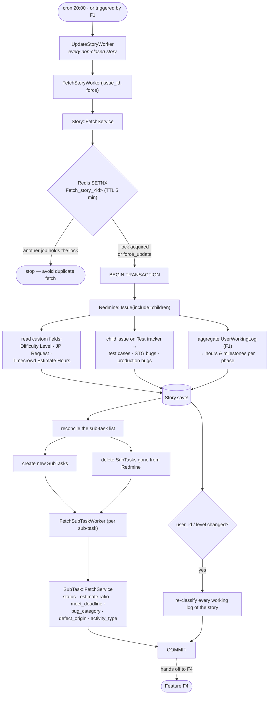
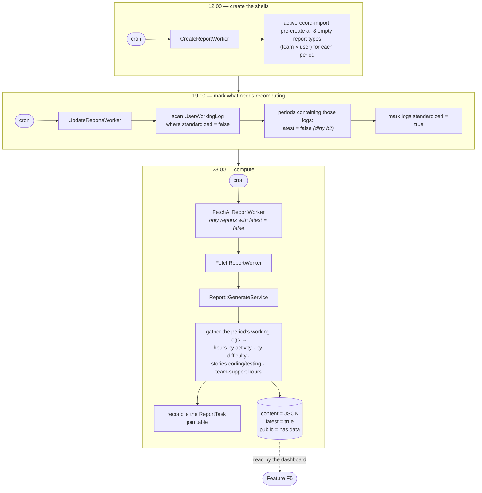
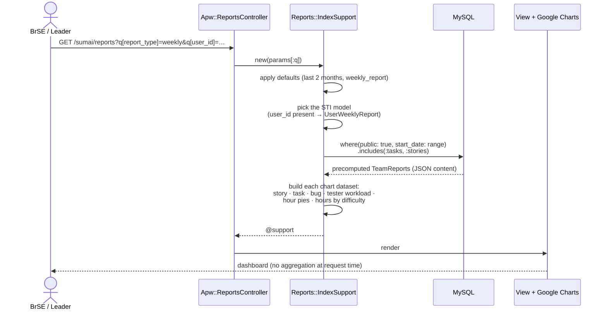

# Report — Automated Productivity Reporting for a Development Team

A Rails application that synchronizes data from **Redmine** (issue tracker) and **TimeCrowd**
(time tracking), normalizes it into structured records, and turns it into a **dashboard for
tracking a development team's progress and productivity** on a daily / weekly / monthly /
quarterly basis.

The goal: replace the manual report assembly from Redmine — which used to cost the BrSE/leader
several hours every week — with a scheduled, fully automated pipeline that also **writes back**
to Redmine to normalize the source data itself (task subjects, issue statuses).

---

## 1. Tech stack

| Layer | Technology |
|---|---|
| Language / Framework | Ruby 3.2.1, Rails 8.0 |
| Database | MySQL 5.7 (`utf8mb4_bin`) |
| Background jobs | Sidekiq + sidekiq-scheduler (cron), Redis |
| Cache / Lock | Redis (`Rails.cache` for HTTP responses, `SETNX` for distributed locking) |
| Frontend | ERB + Propshaft, Hotwire (Turbo/Stimulus), importmap, Tailwind (CDN), jQuery, Google Charts |
| Configuration | `config` gem (`config/settings.yml`) — regexes & business rules kept out of the code |
| Bulk insert | `activerecord-import` |
| Dev environment | Docker Compose (web + mysql + redis + worker) |
| Deployment | Multi-stage Dockerfile (production), Kamal, Thruster |

---

## 2. System overview



**Five core features**, each diagrammed in detail in section 5:

| # | Feature | Trigger | Result |
|---|---|---|---|
| F1 | Collect & classify working logs | cron, 18:30 daily | `UserWorkingLog` tagged with `activity_type` + `root_issue_id` |
| F2 | Sync stories & sub-tasks | cron 20:00 + triggered by F1 | `Story`, `SubTask` with hours split per phase |
| F3 | Generate reports (precompute) | cron 12:00 / 19:00 / 23:00 | `TeamReport.content` (JSON) ready for the dashboard |
| F4 | Write back to Redmine | cron every 10 min, business hours | Normalized subjects/statuses on Redmine |
| F5 | Dashboard & lookup screens | user request | Charts, timeline, story details |

---

## 3. Layered architecture



Conventions worth noting:

- **`app/supports/`** is a project-specific layer (not standard Rails): every screen has one
  object (`Entries::IndexSupport`, `Reports::IndexSupport`, …) that takes `params[:q]`, applies
  default filters, queries, and reshapes the data into exactly what the charts need. Controllers
  are therefore reduced to `@support = Reports::IndexSupport.new(params[:q])`.
- **Workers hold no logic** — they take an id plus options and call a service, so the same call
  can be replayed from the console when a manual re-run is needed.
- **Every service exposes a single public `execute`** — easy to swap out, easy to mock in tests.

---

## 4. Data model



| Model | Role |
|---|---|
| `User` | Team member mapped to a `redmine_id`; carries `role` (brse/dev/tester) and `buffer_rate`, used to judge whether a task met its deadline |
| `Story` | A user story on Redmine (project 17, tracker 12). Stores a snapshot: status, difficulty level, actual hours **split per phase** (requirement / design / coding / testing / bug fixing / release / cross-support), start–end milestones for each phase, test case count, STG & production bug counts |
| `SubTask` | A child task of a story, with `kind` (from the Redmine tracker), `activity_type`, bug classification (`bug_category`, `defect_origin`) and a `meet_deadline` flag |
| `UserWorkingLog` | One Redmine time-entry row after being **classified** into an `activity_type` and attached to its `root_issue_id` (the originating story) |
| `TeamReport` (STI) | A precomputed report. Eight subclasses: `Daily/Weekly/Monthly/QuarterReport` (whole team) and `UserDaily/Weekly/Monthly/QuarterReport` (per person). Figures live in the JSON `content` column |
| `Timecrowd*` | Mirror of members / categories / tasks / time entries from TimeCrowd |

> **The central trade-off:** STI plus a JSON `content` column. Reports are computed ahead of time
> by background jobs and stored denormalized, so the dashboard only reads — it never aggregates
> hundreds of thousands of log rows at request time.

---

## 5. Feature-by-feature flows

### F1 — Collect & classify working logs

Redmine has **no** "type of work" field; that information lives in the subject naming convention
(`3. Coding - ...`, `Leave off - ...`). The service matches those regexes and, when a child issue
doesn't match, **walks up the parent chain** until it finds one — resolving the root story along
the way.



All regexes are declared in `config/settings.yml` — when the team changes its naming convention,
only the YAML changes.

---

### F2 — Sync stories & sub-tasks



A failure at any step rolls the transaction back, **releases the lock**, and re-raises so Sidekiq
retries. `RecordNotUnique` specifically destroys the offending story and all of its sub-tasks so
the next fetch can rebuild them cleanly.

---

### F3 — Generate reports (precompute)



The `latest` flag acts as a **dirty bit**: only the reports actually affected by new logs get
recomputed, instead of rebuilding the entire history every night.

---

### F4 — Write back to Redmine

The system doesn't just read — it edits Redmine to keep the source data clean.

```mermaid
flowchart TD
    subgraph S1["Normalize sub-task subjects — every 10 min"]
        T1(["cron 8:00–18:00"]) --> TSW["TriggerUpdateSubjectRedmineWorker"]
        TSW --> USR["SubTask::UpdateRedmineService"]
        USR --> Q1{"already has the standard prefix?"}
        Q1 -- yes --> MARK["update_title = true<br/><i>never touched again</i>"]
        Q1 -- no --> PUT1["PUT /issues/:id.json<br/>subject = '3. Coding - ...'"]
        PUT1 --> RE1["re-fetch after 10 min<br/>so the DB matches Redmine"]
    end

    subgraph S2["Sync statuses — 8:00 / 12:00 / 17:00"]
        T2(["cron"]) --> TST["TriggerUpdateStatusRedmineWorker"]
        TST --> Q2{"story.released?"}
        Q2 -- yes --> PUT2["PUT status on the story<br/>+ every child issue (2 levels)"]
        PUT2 --> RE2["re-fetch after 10 min"]
    end

    subgraph S3["Create recurring issues — 8:30"]
        T3(["cron"]) --> CSS["CreateStaticStoryWorker"]
        CSS --> POST["POST /issues.json<br/>[ Documents ] · [ Support ] ·<br/>[ Investment Plan ]"]
    end
```



Every request goes through `Redmine::PostBase` / `Redmine::PutBase` — one place handling Basic
Auth, the API key, content type, and raising on unsuccessful responses.

---

### F5 — Dashboard & lookup screens (request flow)



The other screens follow the same shape:

| Route | Support object | Description |
|---|---|---|
| `GET /sumai` | `Entries::IndexSupport` | **Schedule board** — a Gantt-style weekly/monthly timeline of story × sub-task × assignee, filterable by user |
| `GET /sumai/reports` | `Reports::IndexSupport` | **Dashboard** — story counts, on-time tasks, STG vs production bugs, hour distribution by activity and by difficulty, tester workload |
| `GET /sumai/stories/:id` | `Stories::ShowSupport` | One story in detail: sub-task tree, hours per phase, reconciliation against the TimeCrowd estimate |
| `GET /sumai/timecrowds` | `Timecrowds::IndexSupport` | Reconcile TimeCrowd data (JP side) against actually logged hours (VN side) |
| `GET /sumai/ajax/stories` | — | JSON endpoint backing the subject autocomplete box |
| `GET /sumai/sidekiq` | — | Sidekiq Web UI: queues, retries, cron schedule |

---

## 6. Automated schedule (`config/sidekiq_scheduler.yml`)

```mermaid
gantt
    title A day in the life of the system
    dateFormat HH:mm
    axisFormat %H:%M
    section Write-back (F4)
    Normalize subjects (every 10 min)   :08:00, 10h
    Sync statuses (8/12/17)             :milestone, 08:00, 0m
    Create recurring issues             :milestone, 08:30, 0m
    section Reports (F3)
    Create report shells                :milestone, 12:00, 0m
    Mark dirty periods                  :milestone, 19:00, 0m
    Compute report content              :milestone, 23:00, 0m
    section Sync (F1, F2)
    Fetch working logs                  :milestone, 18:30, 0m
    Refresh non-closed stories          :milestone, 20:00, 0m
```



---

## 7. Running the project

```bash
# 1. Start the whole stack (Rails + MySQL 5.7 + Redis)
docker compose up -d

# 2. Create the database and load the schema
docker compose exec web bundle exec rails db:create db:schema:load

# 3. Load master data (users from CSV + report shells from 2023 to today)
docker compose exec web bundle exec rails db:import_master_data

# 4. Run Sidekiq (uncomment the `worker` service in docker-compose.yml)
docker compose exec web bundle exec sidekiq
```

Open <http://localhost:3000/sumai> — Sidekiq UI at <http://localhost:3000/sumai/sidekiq>.

Required environment variables: `DATABASE_HOST` / `DATABASE_USERNAME` / `DATABASE_PASSWORD`,
`REDIS_URL`, `REDMINE_API_KEY`, `BASIC_AUTH_USER_NAME`, `BASIC_AUTH_USER_PASSWORD`.

---

## 8. Directory layout

```
app/
├── controllers/apw/     # Thin controllers, they only instantiate a Support object
├── models/              # ActiveRecord + enums + scopes (no heavy business logic)
├── services/
│   ├── redmine/         # API clients: GetBase / PostBase / PutBase (Template Method)
│   ├── time_crowd/      # TimeCrowd API clients
│   ├── story/           # FetchService, UpdateStatusRedmineService, FindTimeCrowdService
│   ├── sub_task/        # FetchService, UpdateRedmineService
│   ├── report/          # GenerateService — computes the entire report payload
│   └── user_working_logs/  # CategorizeActivities — regex-based log classification
├── workers/             # ~30 Sidekiq workers, each merely delegating to a service
├── supports/            # Per-screen data preparation objects
└── views/apw/           # ERB + Google Charts

config/
├── settings.yml            # Activity regexes, subject conventions, Redis settings
├── sidekiq_scheduler.yml   # The entire cron schedule
└── initializers/scheduler.rb
```

---

## 9. Notable design decisions

1. **Domain services instead of fat models** — models keep only associations, enums and scopes;
   every business flow and external integration lives in a service with one public `execute`.
2. **Workers as thin adapters** — a worker takes an id plus options and calls a service, which
   keeps the logic independently testable and replayable from the console.
3. **Template Method for API clients** — `Redmine::GetBase` owns HTTP, auth, caching and parsing;
   a subclass only declares `full_url` and `response_format`. A new endpoint is ~10 lines.
4. **Caching and distributed locking at the client layer** — Redmine GETs are cached for 5
   minutes and story fetches are guarded by a Redis `SETNX` lock, which sharply cuts request
   volume when many jobs fire at once.
5. **Precomputed reports** — accept data that lags until end of day in exchange for an instant
   dashboard, with the `latest` flag limiting recomputation to what actually changed.
6. **Business rules in configuration** — the activity-detection regexes and the fixed subject list
   live in `settings.yml`, so a change in team convention never touches the code.
7. **Idempotency** — every fetch service uses `find_or_initialize_by` on `issue_id` (which has a
   unique index), so repeated job runs never produce duplicate records.

---

## 10. Known limitations & next steps

Listed candidly, as discussion material:

- **No automated tests** — `test/` currently holds only the skeleton. This is the top priority for
  further work: unit tests for `UserWorkingLogs::CategorizeActivities` and
  `Report::GenerateService` (the most error-prone logic), with WebMock/VCR stubbing the Redmine API.
- **No application-level authentication/authorization** — the system runs on the internal network
  behind Basic Auth; the Sidekiq Web UI has no separate protection either.
- **Secrets sit in `docker-compose.yml`, and a TimeCrowd token is hardcoded in
  `app/services/time_crowd/base.rb`** — all of it should move to environment variables or Rails
  credentials.
- **N+1 queries in the support objects** — a few charts iterate `report.stories` / `report.tasks`
  per period; these could be preloaded or folded into the `content` JSON instead.
- **CI is commented out** (`.github/workflows/ci.yml`) — Brakeman, RuboCop and the test suite need
  to be re-enabled.
- **API error handling is basic** — beyond Sidekiq's default retry there is no tailored
  backoff strategy and no circuit breaker for Redmine downtime.
- **TimeCrowd sync is currently disabled** (several workers commented out) after the JP side
  changed how they use the tool.
